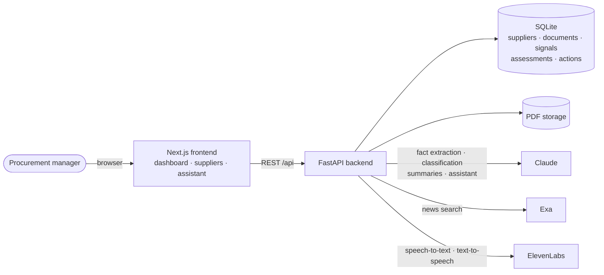
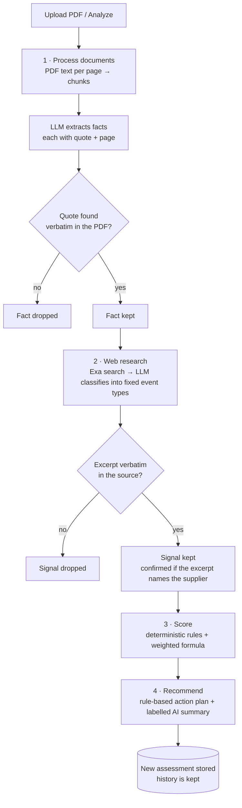
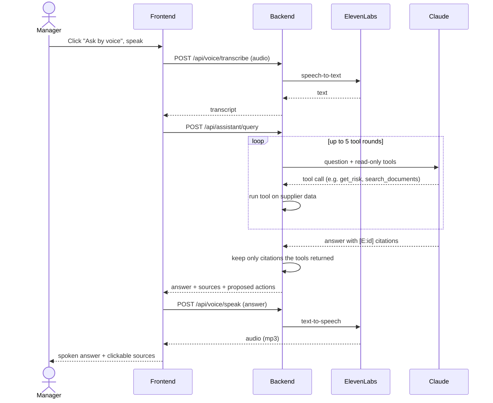

# SupplierLens

**Know your suppliers before their risks become your business problems.**

SupplierLens turns the supplier documents a company already has (financial reports, certificates, delivery reports, contracts) and public news into an **explainable risk score with evidence for every claim**. Procurement managers can then **ask by voice**, in English or German, and get a spoken answer that cites its sources.

> Hackathon prototype. Suppliers in the demo data are **synthetic** and labelled as such; any real company is scored only from public news. Assessments are not financial or legal advice.

---

## The problem

Small and medium-sized manufacturers depend on dozens to hundreds of suppliers, but the information needed to judge them is scattered across PDFs, spreadsheets, inboxes and the news. Supplier reviews happen by hand, once in a while, so warning signs (a net loss, falling on-time delivery, an expired ISO certificate, an insolvency filing) are often found only after production is hit. Enterprise supplier-risk platforms exist, but they target large procurement teams.

## The solution

| Step | What SupplierLens does |
|---|---|
| **1. Extract** | Reads uploaded PDFs and extracts facts (revenue, equity ratio, on-time delivery, certificate expiry…). **Every fact must carry a verbatim quote and page number.** A quote that isn't in the document gets the fact dropped. |
| **2. Research** | Searches public news about the supplier (Exa), classifies each result into a fixed set of risk event types, and keeps the source URL, date and quote. A signal counts as *confirmed* only if the quoted sentence names the company. |
| **3. Score** | Calculates the risk **with deterministic rules and a weighted formula**: the same evidence always gives the same score. Missing data is shown as *Not assessed*, never as low risk. |
| **4. Recommend** | Proposes an action plan (request financials, renew a certificate, qualify an alternative supplier…), each action tied to the evidence that triggered it. **A human approves every action.** |
| **5. Ask** | A voice and text assistant answers questions from the supplier data only, cites its sources, and speaks the answer (ElevenLabs). |

---

## How it works

### Architecture



All provider keys stay on the backend. The browser only talks to the SupplierLens API.

### Analysis pipeline

Uploading a PDF or clicking **Analyze** starts a background run. The frontend polls its progress and shows each step live.



If web research fails, the run still completes and the score is based on documents only.

### Voice assistant



The assistant's tools are read-only, except `propose_action`, which only creates a *proposed* action for the user to approve. The answer language follows the question (German or English).

---

## Risk scoring

Each indicator has a **category**, a **severity** (0–100) and a **confidence** that depends on where it comes from:

| Basis | Confidence | Example |
|---|---|---|
| Document fact (quoted) | 0.9 | "On-time delivery rate: 78.0 %" |
| Web signal, source confirmed | 0.75 | Insolvency filing in the news |
| Web signal, unverified | 0.5 | Same, but the quote doesn't name the company |
| Reference data | 0.7 | Country risk table |
| AI interpretation | 0.4 | A concern the model read into a document |

```
weights: financial 25 % · operational 25 % · delivery 20 % · compliance 15 % · external 15 %

category score = max( confidence-weighted mean severity,
                      highest severity among indicators with confidence ≥ 0.75 )
category assessed only if it has at least one indicator that is NOT an AI interpretation

coverage   = sum of weights of assessed categories
overall    = weighted mean over assessed categories
class      = insufficient data if coverage < 50 %, else low ≤ 30 < medium ≤ 60 < high
```

A confirmed critical finding (e.g. an insolvency) is never averaged away, and an AI interpretation on its own never makes a category look assessed. Thresholds and weights are starting hypotheses, defined in one place: `backend/app/services/risk_engine.py`. Full rules: [`docs/CONTRACT.md`](docs/CONTRACT.md) §5.

### Trust guardrails

- **No fabricated facts:** extracted facts and web signals need a verbatim quote from their source, or they are dropped.
- **Deterministic score:** the model extracts and classifies. It never produces the score.
- **Missing data is visible:** not-assessed categories are grey, never green.
- **Untrusted input:** document and web text are passed to the model as data, inside delimiters, never with write-capable tools.
- **Human in the loop:** proposed actions need approval.
- **Labels:** synthetic suppliers carry a "Synthetic demo data" badge, and AI-written summaries are marked "AI-generated".

---

## Tech stack

| Layer | Technology |
|---|---|
| Frontend | Next.js 16 (App Router), React 19, TypeScript, Tailwind CSS 4, shadcn/ui, Recharts, lucide-react |
| Backend | Python 3.12, FastAPI, Pydantic v2, SQLAlchemy 2, SQLite, pypdf, httpx, `uv` |
| AI | Anthropic Claude (fact extraction, news classification, summaries, tool-using assistant) |
| Web research | Exa |
| Voice | ElevenLabs speech-to-text and text-to-speech (proxied by the backend) |
| Testing | pytest (no network: providers are faked), Playwright browser end-to-end run with a fake microphone |
| CI | GitHub Actions: backend tests, frontend lint, typecheck and build on every PR |

## Repository layout

```
backend/
  app/
    api/            REST routes: suppliers, documents, analysis, dashboard, assistant, voice
    services/       extraction, research, risk_engine, analysis pipeline, assistant, queries
    llm.py          Claude wrapper (structured output with validation and retry)
    models.py       SQLAlchemy models
    schemas.py      API response shapes
  tests/            pytest suite
frontend/
  app/              pages: dashboard, suppliers, supplier detail, assistant
  components/       dashboard, suppliers, risk, assistant, voice, ui
  lib/              API client, types, optional mock data
scripts/            demo PDF generator, demo seeding, browser end-to-end run
demo-data/          synthetic supplier PDFs
docs/               concept, API contract, demo script, pitch
```

---

## Getting started

**Prerequisites:** Python 3.12 with [uv](https://docs.astral.sh/uv/), Node.js 20.9+ with pnpm, and API access to Anthropic, Exa and ElevenLabs.

**1. Configure.** Copy `.env.example` to `.env` in the repo root and fill in the keys. The backend reads:

| Variable | Purpose |
|---|---|
| `ANTHROPIC_API_KEY`, `LLM_MODEL`, `LLM_MODEL_FAST` | Claude access and models |
| `EXA_API_KEY` | web research |
| `ELEVENLABS_API_KEY`, `ELEVENLABS_VOICE_ID`, `ELEVENLABS_TTS_MODEL`, `ELEVENLABS_STT_MODEL` | voice |
| `CORS_ORIGINS`, `MAX_UPLOAD_MB` | allowed frontend origin, upload limit |

The frontend reads `NEXT_PUBLIC_API_URL` (default `http://localhost:8000`) and `NEXT_PUBLIC_API_MOCK` (`1` = run on built-in mock data without a backend). `.env` files are git-ignored; never commit keys.

**2. Run.**

```bash
# backend → http://localhost:8000 (API docs at /docs)
cd backend && uv sync && uv run uvicorn app.main:app --port 8000

# frontend → http://localhost:3000
cd frontend && pnpm install && pnpm build && pnpm start
```

**3. Load the demo data** (4 synthetic suppliers, analysed through the real pipeline, about 1 minute):

```bash
uv run --with fpdf2 python scripts/make_demo_docs.py   # regenerate PDFs (certificate dates are relative to today)
python3 scripts/seed_demo.py                           # add --skip alpha-delivery-performance.pdf to upload it live
```

To start over, stop the backend and delete `backend/data/`.

## Testing

```bash
cd backend && uv run pytest -q                              # unit + pipeline tests, no network
cd frontend && pnpm lint && pnpm typecheck && pnpm build    # frontend checks
```

`scripts/e2e_demo.py` runs the full demo in a real Chromium browser against an empty database: dashboard, live PDF upload that changes the score, evidence opening the source PDF page, action approval, live web research on a real company, a voice question through a fake microphone, a spoken cited answer, a German question, and phone-width layout. See the script's docstring for setup.

## API overview

| Method | Path | Purpose |
|---|---|---|
| GET / POST | `/api/suppliers` | list (sorted by risk) / create |
| GET | `/api/suppliers/{id}` | profile, documents, missing documents, latest run |
| POST | `/api/suppliers/{id}/documents` | upload PDFs |
| GET | `/api/documents/{id}/file` | open a source PDF (`#page=N`) |
| POST | `/api/suppliers/{id}/analyze` | start an analysis run |
| GET | `/api/runs/{id}` | run progress |
| GET | `/api/suppliers/{id}/risk` | latest assessment with indicators and evidence |
| GET | `/api/suppliers/{id}/signals` | web signals |
| GET / PATCH | `/api/suppliers/{id}/actions`, `/api/actions/{id}` | action plan / approve, reject, done |
| GET | `/api/dashboard` | portfolio overview |
| POST | `/api/assistant/query` | ask a question |
| POST | `/api/voice/transcribe`, `/api/voice/speak` | speech-to-text, text-to-speech |

Exact request and response shapes: [`docs/CONTRACT.md`](docs/CONTRACT.md) §4.

---

## Prototype limits and next steps

Deliberate shortcuts for the prototype, each marked `shortcut:` in the code:

- no login or multi-tenant data separation yet;
- SQLite and in-process background jobs (single server);
- keyword search over documents instead of embeddings;
- PDF only, no OCR for scanned documents.

**Next:** customer interviews with procurement managers to validate the problem and pricing, pilots with 3–5 manufacturers, then authentication, Postgres with a job queue, Excel/Word import, and continuous monitoring.

## Documentation

- [`docs/CONTRACT.md`](docs/CONTRACT.md): API contract, data model, scoring rules
- [`CLAUDE.md`](CLAUDE.md): engineering rules for contributors and coding agents
